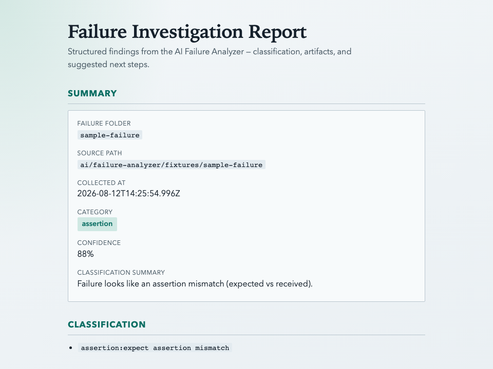
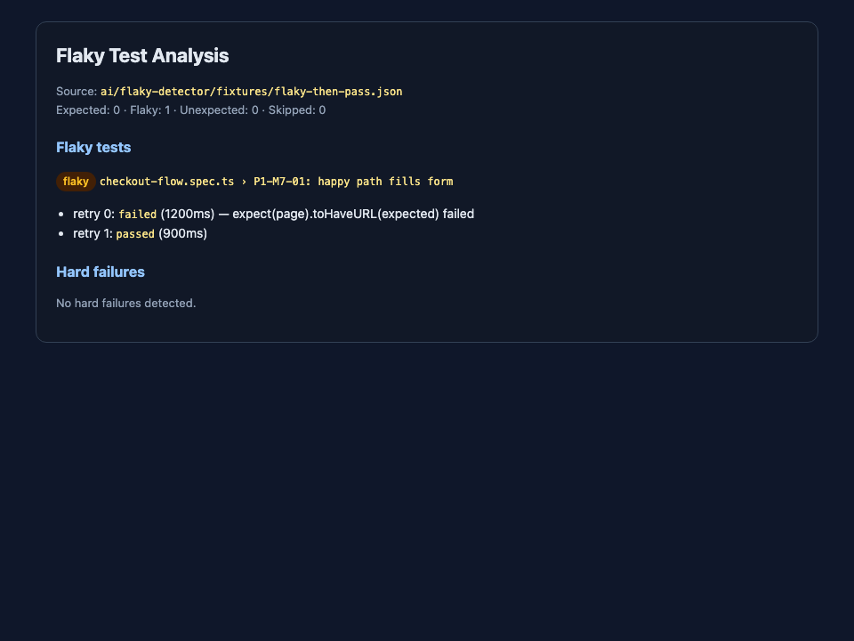
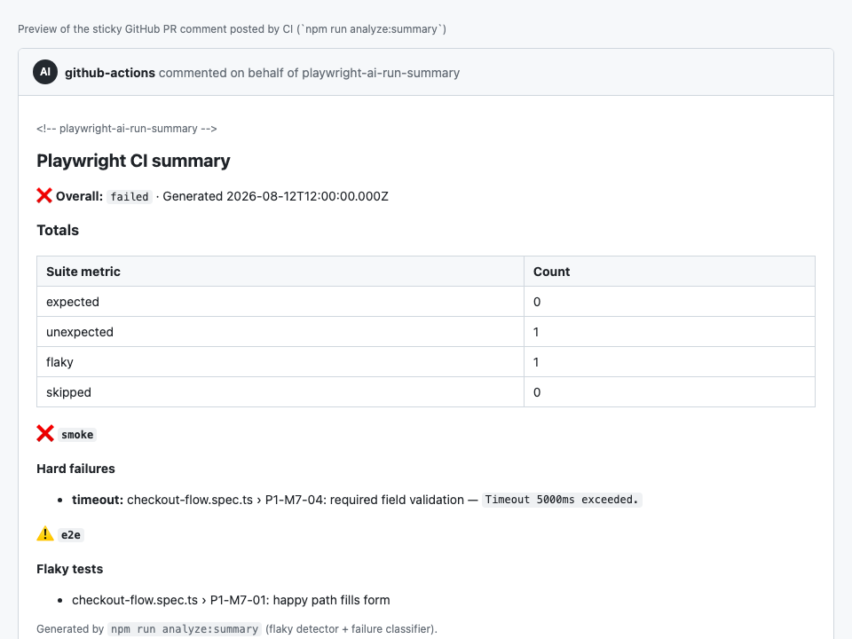
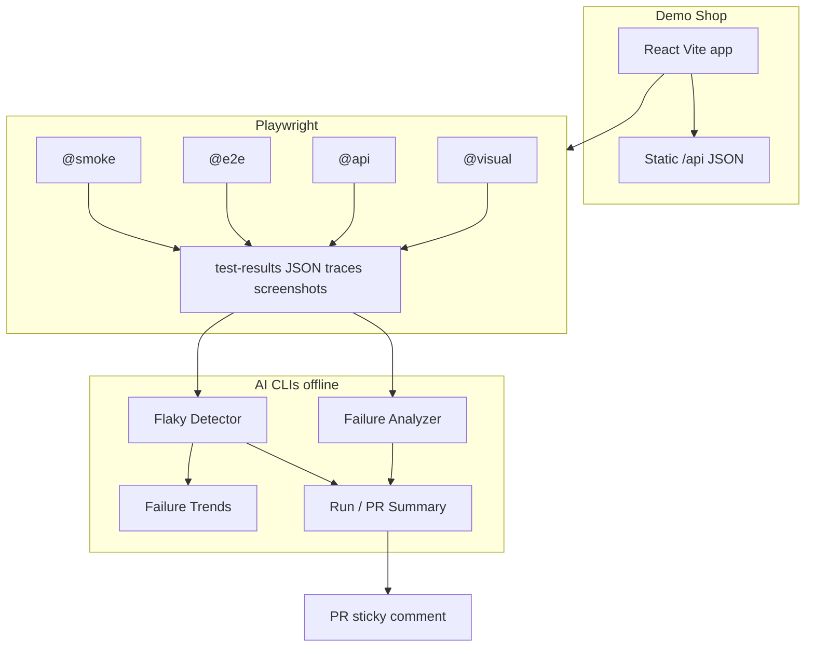

# Playwright AI Test Inspector

[](https://github.com/ksycz/playwright-test-ai-inspector/actions/workflows/playwright.yml)

A portfolio project focused on learning **Playwright** while exploring practical applications of **AI in modern test automation**.

The project combines a small demo e-commerce application with a production-inspired Playwright testing framework and a growing collection of AI-assisted testing tools.

---

## About This Project

As an experienced SDET with several years of experience using Cypress, I wanted to learn Playwright by building something practical instead of following isolated tutorials.

The primary goal is to gain hands-on experience with Playwright while exploring how AI can improve everyday software testing workflows—from investigating failed end-to-end tests to generating actionable debugging insights.

This repository is developed incrementally and serves as both a learning journey and a portfolio project.

---


## Objectives

- Learn Playwright in depth
- Build a maintainable end-to-end testing framework
- Apply modern React and TypeScript best practices
- Explore practical AI use cases in software testing
- Demonstrate clean architecture and professional engineering practices

---


## Technology Stack


### Application

- React
- TypeScript
- Vite
- Tailwind CSS
- React Router
- Context API
- Local Storage


### Testing

- Playwright
- Playwright Trace Viewer
- HTML Reports
- Screenshots & Videos
- Page Object Model
- Fixtures
- Dependency gate (`npm run analyze:deps`)
- Renovate for version updates, Dependabot alerts for vulnerabilities


### AI tooling

- Failure Analyzer (collect → classify → Markdown/HTML reports; optional LLM)
- Flaky Test Detector
- Historical Failure Trends
- Run / PR Summaries
- Visual regression (`@visual` screenshots)
- Playwright MCP (AI-driven exploration and test generation)

---


## Repository Structure

```text
app/            Demo e-commerce application (Vite + React)
tests/          Playwright suites (@smoke, @e2e, @api, @visual)
ai/             Offline AI/QA CLIs (analyzer, flaky, trends, run-summary)
docs/           Specs, testing conventions, roadmap
.github/        CI matrix + PR summary comments
```

---


## Current Status

✅ Phase 1 complete — P1-M1 through P1-M10 (59 smoke tests).

✅ Phase 2 complete — P2-M1 through P2-M8 (framework, POM, fixtures, tagged suites, E2E journeys, CI).

✅ Phase 3 complete — P3-M1 through P3-M5 (ingestion, classification, Markdown/HTML reports, optional LLM, docs polish).

✅ Phase 4 complete — P4-M1 checkout flake fix + P4-M2 flaky test detection.

✅ Phase 5 complete — P5-M1 through P5-M4 (static `/api`, app fetch client, `@api` suite, docs/negatives).

✅ Phase 6 complete — P6-M1 through P6-M3 (Playwright `@visual` screenshot baselines + CI).

✅ Phase 7 complete — P7-M1 through P7-M3 (JSONL run history + Markdown failure trend reports).

✅ Phase 8 complete — P8-M1 through P8-M3 (multi-suite run summary Markdown + sticky PR comments).

✅ Phase 9 complete — dependency gate, Renovate, and a shorter CI run (shared Chromium image, 2 workers).

🚧 Phase 10 in progress — failure text is untrusted data, and model replies must match a short schema before they are shown as plain text. Next is P10-M3, redacting secrets before a provider call.

**Test suites:** 93 Playwright tests across `@smoke`, `@e2e`, `@api`, `@visual`, and fixture examples; plus `npm run test:ai` for analyzer / flaky / trends / summary / dependency-gate unit tests.

---

## Demo in 5 minutes

Full interview script: **[`docs/DEMO.md`](docs/DEMO.md)** (minute-by-minute talking points + copy/paste commands).

| Minute | What to show | Command |
|---|---|---|
| 0–1 | Install + open the shop | `npm run setup` then `npm run dev` → http://localhost:5173 |
| 1–2 | Smoke suite (POM + tags) | `npm run test:smoke` |
| 2–3 | AI failure report (fixture) | `npm run analyze:report -- ai/failure-analyzer/fixtures/sample-failure --format html` |
| 3–4 | Flaky + trends + PR-style summary | Commands below |
| 4–5 | Trace walkthrough | See [Trace walkthrough](#trace-walkthrough) |

```bash
# Flaky detector (fixture — no Playwright run needed)
npm run analyze:flaky -- ai/flaky-detector/fixtures/flaky-then-pass.json

# Historical trends (fixture history)
npm run analyze:trends -- --history ai/failure-trends/fixtures/sample-history.jsonl

# Multi-suite run summary (PR-comment style Markdown)
npm run analyze:summary -- \
  --suite smoke ai/flaky-detector/fixtures/hard-fail.json \
  --suite e2e ai/flaky-detector/fixtures/flaky-then-pass.json
```

### Portfolio screenshots

<p>
  
</p>

<p>
  
</p>

<p>
  
</p>

Sample artifacts: [`docs/samples/`](docs/samples/) (HTML, Markdown, and the screenshots above).

### Known limitations

This is a **portfolio / learning** project, not a production shop:

- **No real backend or database** — catalogue is static JSON under `/api`; cart, auth, and orders live in browser storage.
- **Theatrical auth** — demo credentials ship in the client bundle (`users.json`). Sessions are forgeable in DevTools; passwords are intentionally **not** under `/api`.
- **Client-trusted cart totals** — fine for Playwright practice; not payment-safe.
- **Visual baselines** are tuned for CI Chromium viewports; local OS font differences can cause noise.
- **Optional LLM** (`--llm`) sends failure excerpts to a third party when an API key is set; default tooling is offline.

The engineering value is the **Playwright framework + offline AI CLIs + CI summaries**, not production security or commerce.

---

## Architecture



**Flow in one sentence:** the shop is a static-front-end test bed; Playwright produces artifacts; offline CLIs turn those artifacts into investigation reports, flaky/trend insights, and PR summaries.

---

## Local Development

**Requires Node.js 22.12+** (see `.nvmrc`).

If `nvm` is not found, ensure your shell loads it (add to `~/.zshrc`):

```bash
export NVM_DIR="$HOME/.nvm"
[ -s "$NVM_DIR/nvm.sh" ] && \. "$NVM_DIR/nvm.sh"
```

Then in the project directory:

```bash
nvm install    # installs Node 22 from .nvmrc if needed
nvm use
node -v        # should be v22.12.0 or higher
```

### One-time setup

From the repository root:

```bash
npm run setup
```

This installs root dependencies (Playwright), app dependencies, and the Chromium browser into `.playwright-browsers/` inside the project (avoids permission issues with the global cache).

**Use `npm run setup` or `npm run playwright:install` for browsers — not `npx playwright install`.**  
The raw `npx` command installs to Playwright’s default cache and can appear to hang or leave tests looking for binaries in the wrong place. This repo sets `PLAYWRIGHT_BROWSERS_PATH=.playwright-browsers` in all test scripts.

If a previous install appears stuck, press **Ctrl+C** and run `npm run playwright:install` again.

### Application

```bash
npm run dev
```

Open http://localhost:5173

```bash
npm run build
npm run preview
```

### Playwright

```bash
nvm use
npm test
npm run test:smoke
npm run test:e2e
npm run test:api
npm run test:visual
npm run test:ui
npm run test:headed
npm run report
```

Console output is one line per test: a status mark, the test name, and the duration. A failure also prints the file and the first line of the error. The HTML report and JSON results are unchanged.

```text
  ✓  P1-M1-01: app dev server serves the root page (779ms)
  ✓  P1-M1-02: page has document title and main landmark (787ms)

2 passed (1.9s)
```

Add `--headed` to watch Chromium, for example `npm run test:smoke -- --headed`.

**Debugging failed tests:**

```bash
# Open HTML report from the latest run
npm run report

# Open a trace file captured on retry (path printed in test output)
npm run trace -- test-results/<test-folder>/trace.zip
```

Failure artifacts (screenshots, videos, traces) are written to `test-results/`. See `docs/TESTING.md` for the full debugging workflow.

### Trace walkthrough

Playwright traces are the best “live demo” of debugging quality. This repo captures traces **on first retry** when `CI=true`.

**1. Produce a trace (about 1 minute)**

```bash
# Retries enabled → failed-then-retried tests write trace.zip
CI=true npm run test:smoke -- tests/smoke/error-empty-states.spec.ts
```

If the targeted tests pass cleanly, force a retry path by running under CI against a temporarily broken assertion, or download `test-results-*` from a failed GitHub Actions job (Artifacts).

**2. Open Trace Viewer**

```bash
# Path is printed in the Playwright output for retried tests
npm run trace -- test-results/<failed-or-retried-test-folder>/trace.zip
```

**3. What to narrate in an interview**

- Action timeline + DOM snapshots before/after the failure
- Network / console as supporting evidence
- How this pairs with `npm run analyze:report` (classification + next steps) on the same failure folder

Config reminder: `trace: 'on-first-retry'` in `playwright.config.ts` (screenshots/videos only on failure).

### Continuous Integration

GitHub Actions runs Playwright on every push to `main` and on pull requests:

- **Workflow:** `.github/workflows/playwright.yml`
- **Node:** 22 (from `.nvmrc`)
- **Browsers:** project-local Chromium in `.playwright-browsers/`
- **Suites:** `test:smoke`, `test:e2e`, `test:api`, and `test:visual` run in parallel matrix jobs
- **On failure:** `playwright-report/` and `test-results/` are uploaded as downloadable artifacts
- **Always:** `playwright-json-<suite>` artifacts feed the AI run-summary job
- **Pull requests:** sticky AI run summary comment after the matrix finishes, plus the new-dependency gate against the PR base (see below)
- **Install:** `npm ci` (root, and `app/` where the job needs it), not `npm install`
- **Audit:** `npm audit --audit-level=high` for the root and app lockfiles
- **Docs-only pull requests:** a change that only touches `docs/` or Markdown skips the test jobs. Suite jobs use the Playwright container image that matches the installed `@playwright/test` version, and they run with 2 workers. The gates and the Renovate versus Dependabot split are in [`docs/TESTING.md`](docs/TESTING.md).

Local runs use `CI=true` to match CI behaviour (fresh dev server, retries, traces on first retry).

### Dependency gate

`npm run analyze:deps` compares `package.json` and `app/package.json` with a git ref. It checks **new package names** only. A version bump of a package that is already in the base is ignored.

A new package fails when any of these are true:

- it does not exist on the npm registry
- it was published less than 7 days ago
- it has fewer than 1000 weekly downloads

The failure line names the file, the package, and the rule.

**See a pass** (no network when nothing is new):

```bash
npm run analyze:deps -- --base HEAD
```

Expected: `Dependency gate passed.`

**See a failure**, then put `package.json` back:

```bash
npm pkg set dependencies.not-a-real-package-xyz=1.0.0
npm run analyze:deps -- --base HEAD
git checkout -- package.json
```

Expected:

```text
Dependency gate failed:
package.json: not-a-real-package-xyz: package was not found on the npm registry
```

**Run the offline unit tests** (unknown package, too young, too few downloads, version bump ignored):

```bash
node --experimental-strip-types --test ai/dep-gate/gate.test.mts
```

On a pull request, the **New dependency gate** job runs the same command against the PR base commit. Pushes to `main` still run the audit, and they do not run the new-package check.

If tests fail with a missing browser error, run:

```bash
npm run playwright:install
```

---


## AI Modules


### AI Failure Analyzer

The first AI module assists with failed Playwright test investigations.

**One-command flow** (after a local or CI failure):

```bash
npm run analyze:report -- test-results/<failed-test-folder> --format both
```

That collects artifacts, classifies the failure, and writes Markdown + HTML reports under `ai-reports/`.

```bash
# Golden fixture (no Playwright run required)
npm run analyze:report -- ai/failure-analyzer/fixtures/sample-failure --format html

# JSON-only collection
npm run analyze:failure -- test-results/<failed-test-folder>

# Analyzer unit tests
npm run test:ai
```

It collects information such as:

- stack traces / error context (`error-context.md`)
- Playwright traces
- screenshots
- videos

Then classifies the failure and writes a structured report with suggested next steps (Markdown by default; HTML via `--format html`).

Optional LLM root-cause suggestions run when `OPENAI_API_KEY` or `ANTHROPIC_API_KEY` is set (`--llm` / `--no-llm` override). Without keys, everything stays offline.

Sanitized sample report: [`docs/samples/failure-investigation-report.md`](docs/samples/failure-investigation-report.md).  
Module docs: [`ai/failure-analyzer/README.md`](ai/failure-analyzer/README.md).

On CI failure, download the `test-results-*` artifact, unzip, and point `analyze:report` at the failed folder — see Testing docs for the full workflow.

The goal is not to replace engineers, but to reduce investigation time and improve debugging efficiency.

### Flaky Test Detector

After a suite run (especially with CI retries), analyze the Playwright JSON report:

```bash
npm run analyze:flaky
npm run analyze:flaky -- ai/flaky-detector/fixtures/flaky-then-pass.json
```

Distinguishes **flaky** (failed then passed on retry) from **hard failures** (failed all attempts).  
Module docs: [`ai/flaky-detector/README.md`](ai/flaky-detector/README.md).

### Historical Failure Trends

Append suite summaries to JSONL history, then render a Markdown trend report:

```bash
npm run analyze:trends -- --history ai/failure-trends/fixtures/sample-history.jsonl
npm run analyze:trends -- --record
npm run analyze:trends
```

Shows top failing tests, flaky hotspots, and light failure-category totals over time.  
Module docs: [`ai/failure-trends/README.md`](ai/failure-trends/README.md).

### AI Run / PR Summaries

Build a PR-comment-friendly Markdown summary from one or more Playwright JSON reports:

```bash
npm run analyze:summary -- \
  --suite smoke ai/flaky-detector/fixtures/hard-fail.json \
  --suite e2e ai/flaky-detector/fixtures/flaky-then-pass.json
```

On pull requests, CI posts (and updates) a sticky summary comment after the matrix suites finish.  
Module docs: [`ai/run-summary/README.md`](ai/run-summary/README.md).

### AI-assisted test generation with Playwright MCP

[Playwright MCP](https://github.com/microsoft/playwright-mcp) lets an AI agent drive a real browser and read the page's accessibility tree. This repo ships the config for it, pinned to one version: [`.mcp.json`](.mcp.json) for Claude Code and [`.cursor/mcp.json`](.cursor/mcp.json) for Cursor. It uses your installed Chrome.

**How I used it**

1. Started the shop with `npm run dev` and asked Claude Code to explore it through the MCP server, comparing what it found with the existing suites.
2. The agent browsed, logged in, and placed an order, using accessibility snapshots to see the roles and names on each page.
3. I kept the scenarios that weren't already covered and had them rewritten with this repo's page objects and test data: [`tests/e2e/mcp-explored-journeys.spec.ts`](tests/e2e/mcp-explored-journeys.spec.ts).
4. I ran the spec repeatedly to check for flakiness before keeping it.

**What it added**

- A two-product total that stays the same from cart through confirmation
- The cart being kept after logout
- The order number being kept after reloading the confirmation page
- Checkout redirecting to the empty cart after an order
- A failed login still returning to checkout after a successful retry
- Login ignoring a redirect to another site
- Checkout rejecting a name containing only spaces
- Quantity and line subtotal showing at checkout and confirmation

**What needed human review**

- The first generated draft had a wrong assertion: `cart-total` contains only the amount, without the `Total:` label.
- Repeated runs exposed an intermittent timeout. `getByLabel('Name')` also matched **User**name, so the page object could type into the login form while it was still on screen. The fix is an exact match in [`checkout-page.ts`](tests/pages/checkout-page.ts).
- Exploration also found behaviour that isn't confirmed as intended, so it's noted here rather than locked in as tests:
  - Logged-in users still see the form at `/login`.
  - `/favicon.ico` returns a 404.
  - The last order is still shown after logging out and back in.
  - The ZIP code field accepts values like `abc`.
  - Focus stays on **Place order** after a failed checkout submit.

MCP is a development aid only: CI runs the committed specs and doesn't need an AI agent or the MCP server.

### Future AI Modules

- Locator Change Suggestions
- Visual Regression Insights

---


## Development Principles

This project follows several engineering principles:

- Clean Architecture
- Readable and maintainable code
- Strong TypeScript typing
- Reusable components
- Stable Playwright locators
- Accessible UI
- Small, focused Git commits
- AI used as an engineering assistant—not as a replacement for engineering judgment

---


## Documentation

Additional documentation is available in the `docs` directory.

- [`DEMO.md`](docs/DEMO.md) — 5-minute interview demo script
- [`PROJECT.md`](docs/PROJECT.md) — vision and development principles
- [`ARCHITECTURE.md`](docs/ARCHITECTURE.md) — architectural decisions (app, tests, AI, CI)
- [`APP_SPEC.md`](docs/APP_SPEC.md) — demo shop functional specification
- [`AI_GUIDELINES.md`](docs/AI_GUIDELINES.md) — AI-assisted development guidelines
- [`LESSONS_LEARNED.md`](docs/LESSONS_LEARNED.md) — learning notes (current state + history)
- [`TESTING.md`](docs/TESTING.md) — Playwright conventions, suites, AI CLIs, CI
- [`ROADMAP.md`](docs/ROADMAP.md) — milestone plan and progress log
- [`samples/`](docs/samples/) — sanitized analyzer samples + README screenshots

Module READMEs: [`ai/failure-analyzer`](ai/failure-analyzer/README.md), [`ai/flaky-detector`](ai/flaky-detector/README.md), [`ai/failure-trends`](ai/failure-trends/README.md), [`ai/run-summary`](ai/run-summary/README.md), [`app/public/api`](app/public/api/README.md).

---


## Development Workflow

The project is developed incrementally.

Each milestone includes:

1. Planning the implementation
2. Building the feature
3. Reviewing the architecture
4. Documenting important decisions
5. Maintaining a clean Git history

---

## Project Roadmap


### MVP

- [x] Initialize React application

- [x] Configure Tailwind CSS

- [x] Implement fake authentication

- [x] Build product catalogue

- [x] Build shopping cart

- [x] Implement checkout flow

- [x] Add responsive layout


### Playwright

- [x] Configure Playwright

- [x] Create Page Object Model

- [x] Implement fixtures

- [x] Organize test data

- [x] Generate HTML reports

- [x] Enable Trace Viewer

- [x] Capture screenshots and videos

- [x] Add smoke tests

- [x] Add end-to-end test suite

- [x] Add API contract suite (`@api`)

- [x] Add visual regression suite (`@visual`)


### CI/CD

- [x] Configure GitHub Actions

- [x] Upload test artifacts

- [x] Publish Playwright reports

- [x] Sticky AI run summary on pull requests

- [x] Install from the lockfile and fail high-severity audits

- [x] Reject new packages that are missing, younger than 7 days, or below 1000 weekly downloads

- [x] Renovate opens version updates; Dependabot alerts stay on and Dependabot version updates stay off


### AI

- [x] AI Failure Analyzer

- [x] Failure classification

- [x] AI investigation reports

- [x] AI debugging suggestions

- [x] Flaky test detection

- [x] Historical failure trends

- [x] Run / PR summaries


### Future Enhancements

- [ ] Locator change suggestions

- [ ] Visual regression insights (beyond `@visual` baselines)

---


## Learning Goals

This repository documents my journey of learning:

- Playwright
- Modern React architecture
- TypeScript
- End-to-end testing best practices
- AI-assisted software engineering
- Practical AI applications in software quality assurance

---


## License

This repository is intended for educational and portfolio purposes.